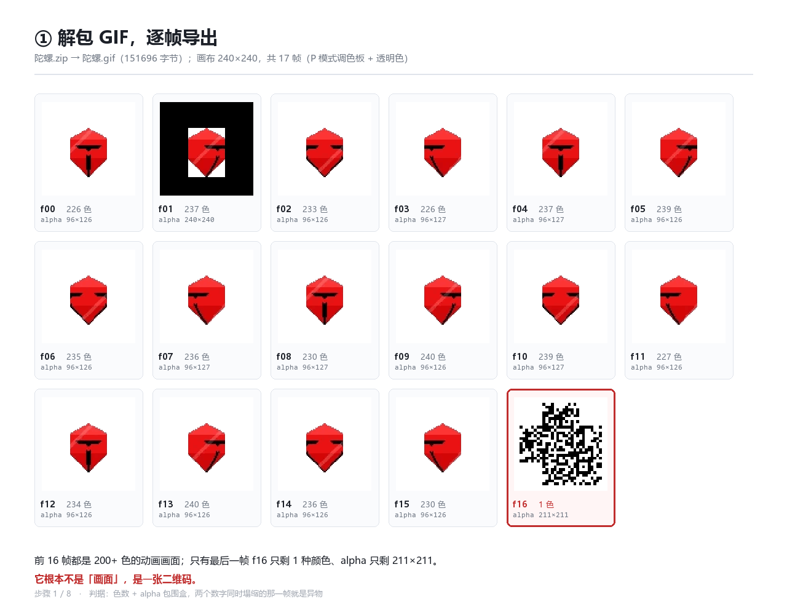
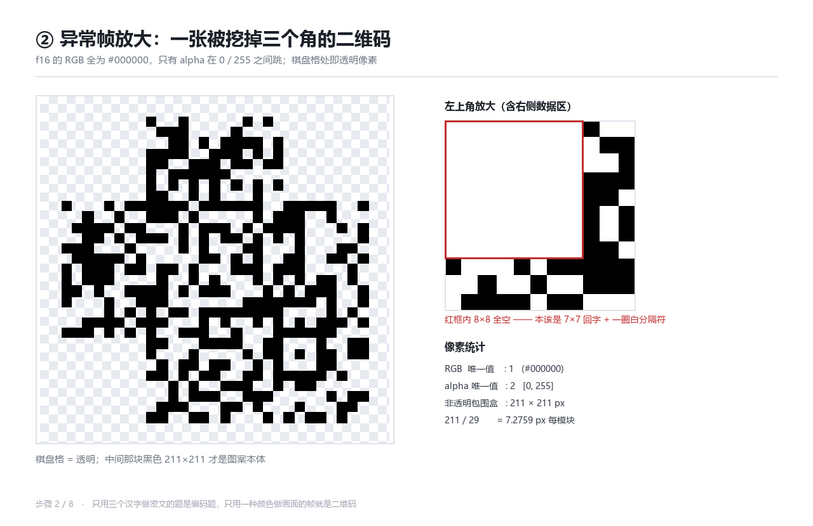
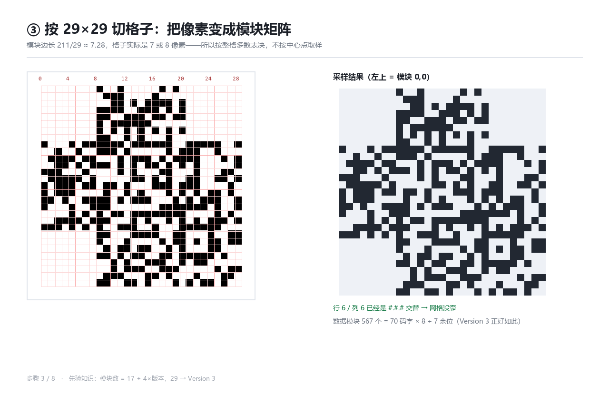
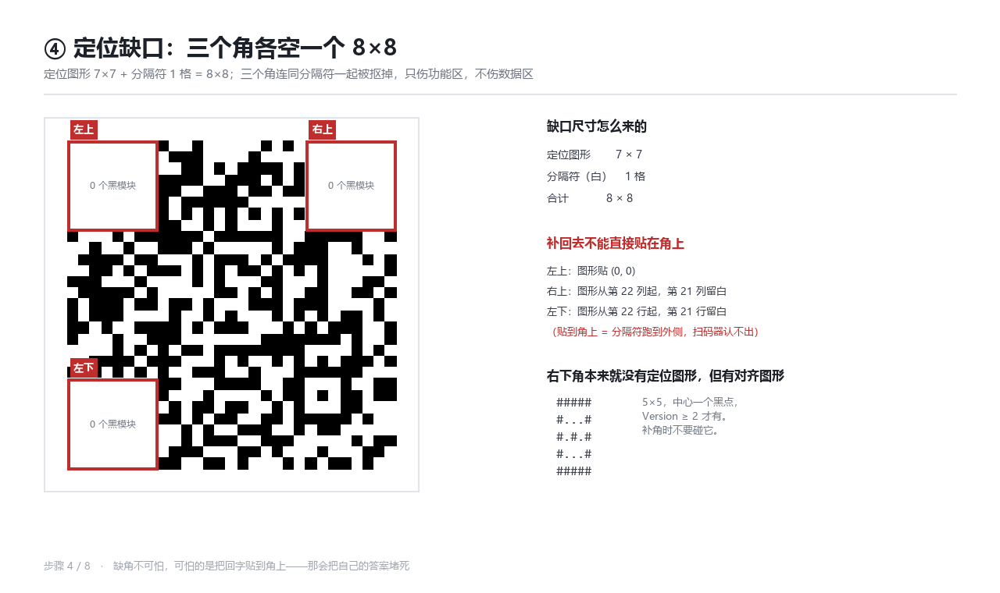
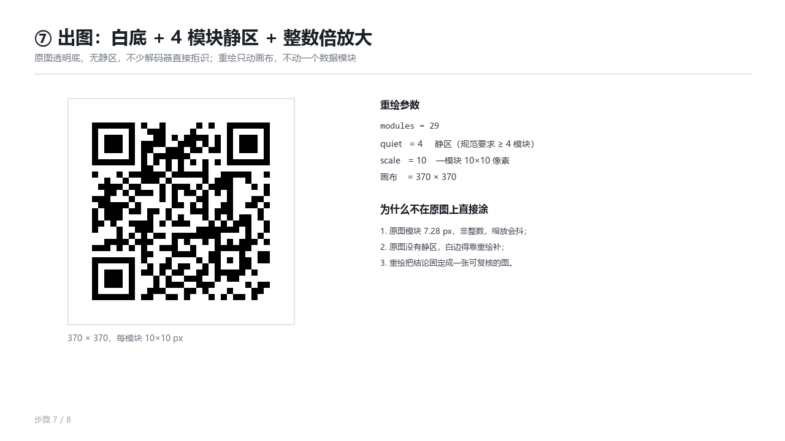
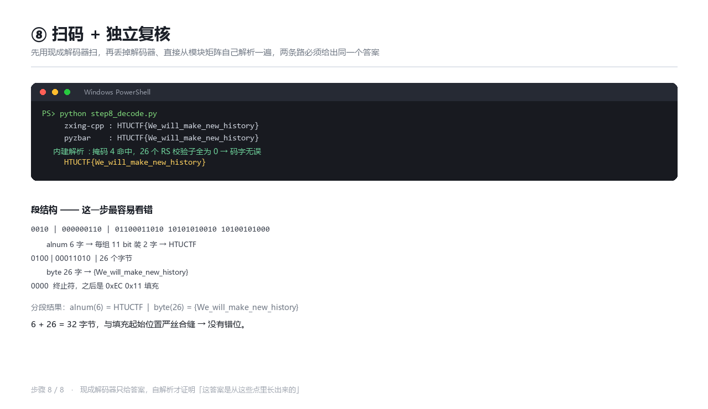

# 陀螺 — Writeup（含 8 个可单跑的步骤脚本）

**题目类别：** Misc（GIF 帧隐写 + 残缺二维码修复）
**附件：** `陀螺.zip` → `陀螺.gif`（151696 字节，240×240，17 帧）
**Flag：**

```text
HTUCTF{We_will_make_new_history}
```

---

## 0. 一句话结论

GIF 的第 17 帧不是动画，是一张**被抠掉三个定位图形的 Version 3 二维码**（29×29）。
把三个角按标准补回去 → 白底加静区重绘 → 扫码得到 flag。

难点不在"补回形"，而在两个细节：

1. 三个 8×8 里，**只有左上角是贴着角的**，右上和左下必须各内缩 1 格，把最外一行/列留成白色分隔符；
2. 二维码的 payload 不是一段 byte 模式，而是 **alnum(6) + byte(26) 两段**，按"首字节必须是 0x4x"去套会以为数据是乱的。

---

## 1. 文件清单（脚本 ↔ 产物 ↔ 截图）

| 步骤 | 脚本 | 输入 | 输出 | 截图 |
|---|---|---|---|---|
| 1 | `step1_unpack.py` | `陀螺.zip` | `frames/f00..f16.png` | `步骤截图/01_拆帧与异常帧.png` |
| 2 | `step2_find_odd.py` | `frames/` | 异常帧判定 | `步骤截图/02_异常帧放大.png` |
| 3 | `step3_sample.py` | `frames/f16.png` | `work/M_raw.npy` | `步骤截图/03_模块采样.png` |
| 4 | `step4_gaps.py` | `M_raw.npy` | 三个缺口坐标 | `步骤截图/04_定位缺口.png` |
| 5 | `step5_patch.py` | `M_raw.npy` | `work/M_patched.npy` | `步骤截图/05_补定位图形.png` |
| 6 | `step6_verify.py` | `M_patched.npy` | 自检结论 | `步骤截图/06_自检.png` |
| 7 | `step7_render.py` | `M_patched.npy` | `输出/修复二维码_白底静区.png` | `步骤截图/07_出图.png` |
| 8 | `step8_decode.py` | 上面那张 PNG + `M_patched.npy` | flag | `步骤截图/08_扫码结果.png` |

`_common.py` 只放画布/字体/画矩阵这些排版工具，不含解题逻辑；`solve.py` 依次调用 1→8。

```bash
python solve.py            # 一次跑完，0.9 秒
python step5_patch.py      # 也可以只重跑某一步（自动用上一步的产物）
```

依赖：`Pillow`、`numpy`；扫码用 `zxing-cpp` + `pyzbar`（两个都装了才做交叉验证）。
第 8 步即使两个库都没装也能出结论——脚本里带了自解析实现。

---

## 2. 步骤 1：解包并拆帧

**目的**：GIF 是逐帧动画，异常信息通常藏在"某一帧"里，先摊开看。

```bash
python step1_unpack.py
```

**关键代码**（`step1_unpack.py`）：

```python
im = Image.open(gif)
frames = [fr.convert("RGBA") for fr in ImageSequence.Iterator(im)]

stats = []
for i, fr in enumerate(frames):
    fr.save(FRAMES / f"f{i:02d}.png")
    cols = fr.convert("RGB").getcolors(maxcolors=1 << 20) or []   # 唯一色数
    bb = fr.split()[3].getbbox()                                  # alpha 包围盒
    stats.append((len(cols), f"{bb[2]-bb[0]}×{bb[3]-bb[1]}" if bb else "空"))
```

**实测输出**：17 帧，前 16 帧 226~240 色、alpha 包围盒 96×126（动画画在中间），
只有 f16 是 **1 色 + 211×211**。

```text
f00.png  色数  226  alpha 96×126
...
f15.png  色数  230  alpha 96×126
f16.png  色数    1  alpha 211×211      ← 异物
```



---

## 3. 步骤 2：放大看它到底是什么

**目的**：确认 f16 的像素构成，别急着当乱码。

```bash
python step2_find_odd.py
```

**关键代码**：

```python
alpha = np.array(fr)[:, :, 3]
ys, xs = np.where(alpha > 0)
w = xs.max() - xs.min() + 1          # 211
module_px = w / 29                   # 7.2759
```

**实测**：

```text
RGB  唯一值    : 1   (#000000)
alpha 唯一值   : 2   [0, 255]
非透明包围盒   : 211 × 211 px
211 / 29       = 7.2759 px 每模块
```

黑底 + 只有 alpha 在 0/255 之间跳 = 一张"透明底黑模块"的二维码，而且左上角那一块是空的。



---

## 4. 步骤 3：按 29×29 切格子

**目的**：把像素变成布尔矩阵。两个决定都要在这一步定死。

**关键代码**：

```python
N = 29                                        # 29 = 17 + 4×3 → Version 3
by, bx = bounds(211, N), bounds(211, N)       # 四舍五入分格，格子 7 或 8 px

for r in range(N):
    for c in range(N):
        M[r, c] = sub[by[r]:by[r+1], bx[c]:bx[c+1]].mean() >= 0.5   # 整格多数表决
```

- **为什么 29**：图上第 6 行 / 第 6 列的黑白交替正好 13 个模块（cols 8~20），
  `8 + 13 + 8 = 29`；套 `17 + 4×version` 得 Version 3。
- **为什么不取中心点**：211 / 29 = 7.2759，格子宽 7~8 像素不均匀，中心点会踩边界。
  整格多数表决对 ±0.5 像素的抖动免疫。

**实测**：`row6[8..20] = #.#.#.#.#.#.#`，矩阵里左上 / 右上 / 左下三块 8×8 全空。



---

## 5. 步骤 4：定位三个缺口

**目的**：确认缺口是 8×8，并且想清楚补的时候该贴在哪。

```bash
python step4_gaps.py
```

**关键代码**：

```python
BLOCKS = [((0, 0), (0, 0)),                # 8×8 块 + 7×7 图形左上角
          ((0, N - 8), (0, N - 7)),        # 右上：图形内缩 1 列
          ((N - 8, 0), (N - 7, 0))]        # 左下：图形内缩 1 行

for (br, bc), _ in BLOCKS:
    assert M[br:br+8, bc:bc+8].sum() == 0     # 三个 8×8 必须全空
```

**实测**：

```text
块 ( 0, 0) 8×8 内黑模块 = 0
块 ( 0,21) 8×8 内黑模块 = 0
块 (21, 0) 8×8 内黑模块 = 0
```

为什么是 8×8：定位图形 7×7 + 白色分隔符 1 圈 = 8×8，抠图的人是连分隔符一起抠的，
所以补的时候也得把分隔符一起还回去 —— 这就是"内缩一格"的来历。



---

## 6. 步骤 5：补回定位图形（本题唯一真正的坑）

```bash
python step5_patch.py
```

**关键代码**：

```python
FINDER = ["#######", "#.....#", "#.###.#", "#.###.#", "#.###.#", "#.....#", "#######"]

P = M.copy()
for (br, bc), (fr, fc) in BLOCKS:
    P[br:br+8, bc:bc+8] = False                 # ① 8×8 清零（顺带得到分隔符）
    for i, row in enumerate(FINDER):            # ② 在正确位置画 7×7
        for j, ch in enumerate(row):
            if ch == "#":
                P[fr+i, fc+j] = True
```

三个 8×8 块里，回字的左上角分别是 `(0,0)`、`(0,22)`、`(22,0)`。
**如果三个都贴角**（`(0,0)`、`(0,21)`、`(21,0)`）：看着三个回字都在，但分隔符跑到了外侧，
扫码器按 1:1:3:1:1 找图形时直接判失败。我第一版就是这么补的，`zxing-cpp` 和 `pyzbar` 全返回空。

**实测**：改动 99 个模块，`assert` 校验全部落在三个 8×8 内。

```text
[step5] 补三个角的定位图形
    改动 99 个模块，全部落在三个 8×8 块内
```


---

## 7. 步骤 6：补完自检（三条硬指标）

```bash
python step6_verify.py
```

**关键代码**：

```python
row  = "".join("#" if P[6, c] else "." for c in range(8, 21))
col  = "".join("#" if P[r, 6] else "." for r in range(8, 21))
dark = bool(P[21, 8])                       # 4×版本+9 = 21 行的暗模块，恒黑
data = int((~function_mask()).sum())        # 非功能区模块数

assert row == col == "#.#.#.#.#.#.#" and dark and data == 567
```

**三条实测全过**：

| 指标 | 实测 | 要求 |
|---|---|---|
| 时序行 row6[8..20] | `#.#.#.#.#.#.#` | 严格交替 |
| 时序列 col6[8..20] | `#.#.#.#.#.#.#` | 严格交替 |
| 暗模块 M[21][8] | `True` | 恒黑 |
| 数据模块数 | `567` | 70×8 + 7 余位 |

`567` 是关键的交叉验证：它等于 Version 3 的 70 个码字 × 8 位 + 7 个余位。
数据模块数对得上，说明功能区挖得干净、补的也只是功能区，**没有误伤数据**。


---

## 8. 步骤 7：出图（白底 + 静区 + 整数倍）

```bash
python step7_render.py
```

**为什么要重绘而不是在原图上涂**：

1. 原图模块 7.2759 px，非整数，任何缩放都会让边界抖动；
2. 原图透明底、**没有静区**（quiet zone），不少解码器见到没有白边直接拒识；
3. 重绘 = 把结论固定成一张只依赖矩阵的图，可复核。

**关键代码**：

```python
n, scale, quiet = 29, 10, 4
img = Image.new("RGB", ((n + 2*quiet) * scale,) * 2, (255, 255, 255))
for r in range(n):
    for c in range(n):
        if M[r, c]:
            d.rectangle([(c+quiet)*scale, (r+quiet)*scale,
                         (c+quiet+1)*scale - 1, (r+quiet+1)*scale - 1], fill=(0, 0, 0))
```

产物：`输出/修复二维码_白底静区.png`（370×370）、`输出/修复二维码_无静区.png`。



---

## 9. 步骤 8：扫码 + 独立复核

```bash
python step8_decode.py
```

**实测**：

```text
zxing-cpp : HTUCTF{We_will_make_new_history}
pyzbar    : HTUCTF{We_will_make_new_history}
内建解析  : 掩码 4 命中，26 个 RS 校验子全为 0 → 码字无误
HTUCTF{We_will_make_new_history}
```

扫码器是黑盒，给答案不给理由，所以脚本里另写了一条**不依赖任何扫码库**的路：
读格式信息拿掩码 → 反掩码 → 之字形取 70 个码字 → GF(2⁸) 算 RS 校验子 → 按段解析。

**关键代码**：

```python
def bit_order(M, mask):                 # 之字形取位 + 反掩码，第 6 列整列跳过
    ...
    while col > 0:
        if col == 6:
            col -= 1
        for r in (range(n - 1, -1, -1) if up else range(n)):
            for c in (col, col - 1):
                if not func[r, c]:
                    coords.append((r, c))
        up = not up
        col -= 2
    return [int(M[r, c]) ^ (1 if mask_bit(r, c, mask) else 0) for r, c in coords]


def rs_syndromes(cw, nsym=26):          # GF(2^8)，本原多项式 0x11d
    ...
    for i in range(nsym):
        s = 0
        for c in cw:
            s = mul(s, exp[i]) ^ c      # Horner：多项式在 α^i 处的取值
        out.append(s)
    return out
```

`26` 个校验子全 0 = 这 70 个码字是合法 RS 码字，即**读码字这一步没有任何一位读错**。
这比"扫出来了"强：扫出来可能是某个库的容错蒙对，RS 全零说明数据本身是对的。

**段结构（最容易看错的一步）**：

```text
0010 | 000000110 | 01100011010 10101010010 10100101000     alnum, 6 字 → HTUCTF
0100 | 00011010  | 26 个字节                                byte, 26 字 → {We_will_make_new_history}
0000                                                        终止符
11101100 00010001 ...                                       填充 0xEC 0x11
```

`alnum` 模式用 11 bit 装 2 个字符，所以 `HTUCTF` 只花 33 bit；`{` 不在字母数字表里，
编码器于是切成第二段 byte。总长 6 + 26 = 32 字节，和填充起始位置（第 34 个码字）严丝合缝。

如果按"第一个字节必须是 0x4x（byte 模式）"去硬套，读出来是 `20 33 1a aa ...`，
看着像乱码——我第一次就卡在这，把 8 种掩码全试了一遍都没结果。



---

## 10. 五处互相咬合的数字（判断"真解出来了"而不是"看着像"）

| # | 数字 | 来源 A | 来源 B |
|---|---|---|---|
| 1 | 29 模块 | 211 / 7.2759 | 17 + 4 × 3 |
| 2 | 13 个交替 | 时序行 cols 8..20 | 29 − 8 − 8 |
| 3 | 567 数据模块 | 非功能区逐格计数 | 70 × 8 + 7 |
| 4 | 70 码字 | 567 // 8 | 44 数据 + 26 纠错 |
| 5 | 32 字节 payload | alnum 6 + byte 26 | 填充起点 − 头部 12 bit |

## 11. 可复现性

```bash
python step1_unpack.py && python step2_find_odd.py && python step3_sample.py \
  && python step4_gaps.py && python step5_patch.py && python step6_verify.py \
  && python step7_render.py && python step8_decode.py
# 或者
python solve.py
```

每一步都会在 `步骤截图/` 落一张图；脚本里的 `assert` 是硬断言：
网格歪了、补丁位置错了、RS 校验不过，都会当场报错，不会给出一个"看起来像 flag"的结果。

---

> 说明：文中所有数字均来自本机实际运行输出（`python solve.py`，0.9s），脚本与截图同目录，可原样复跑。
