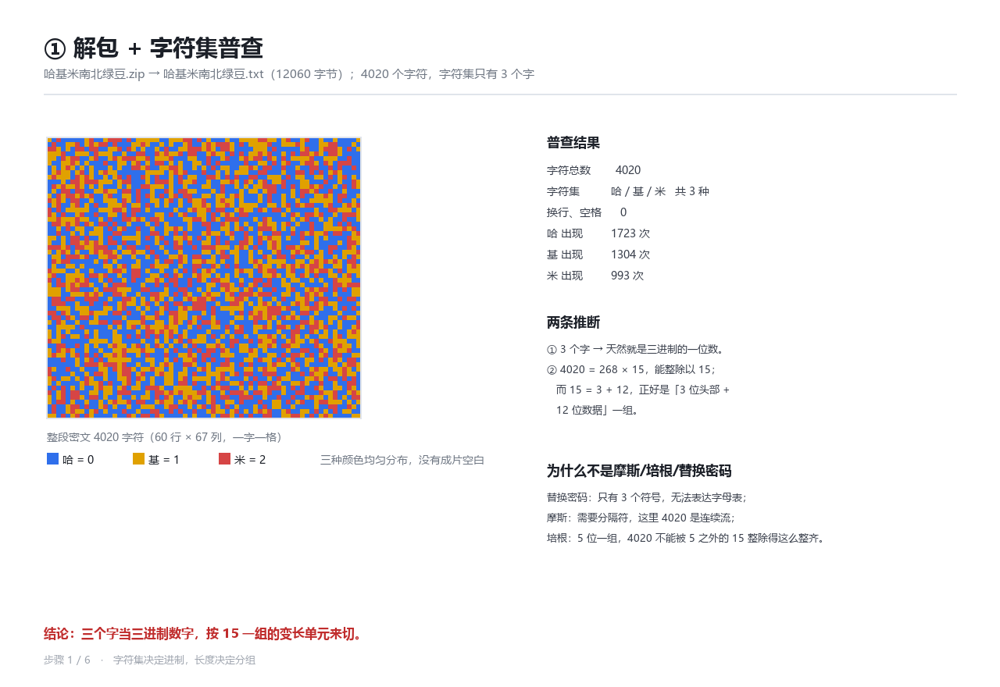
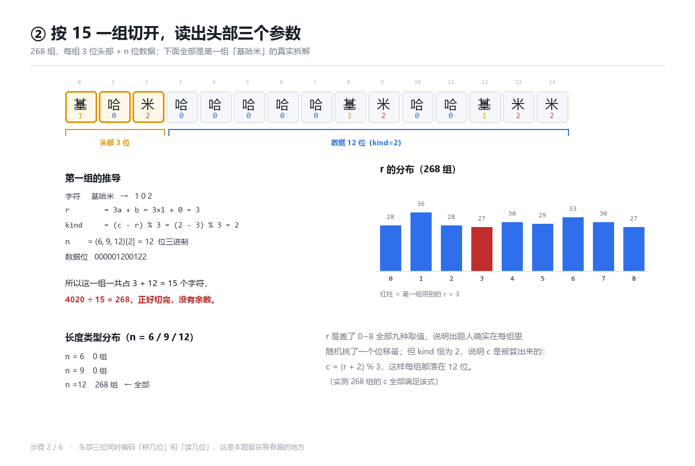
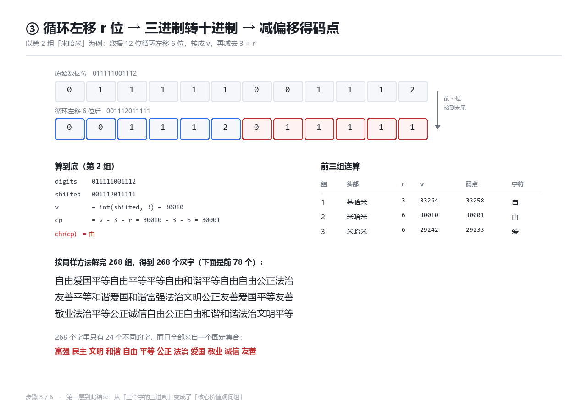
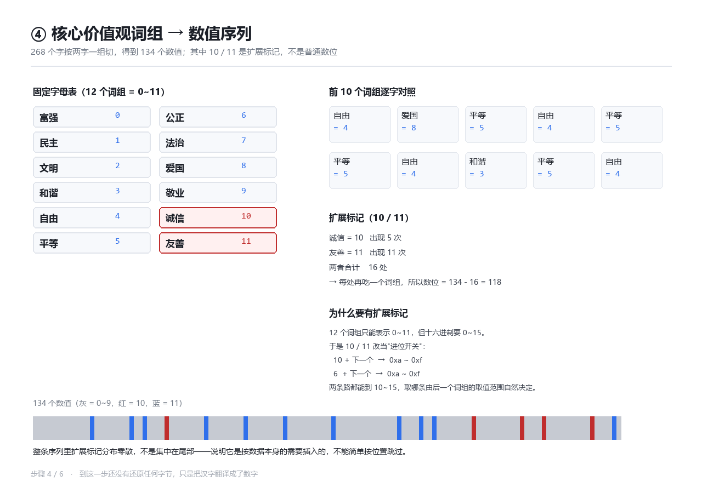
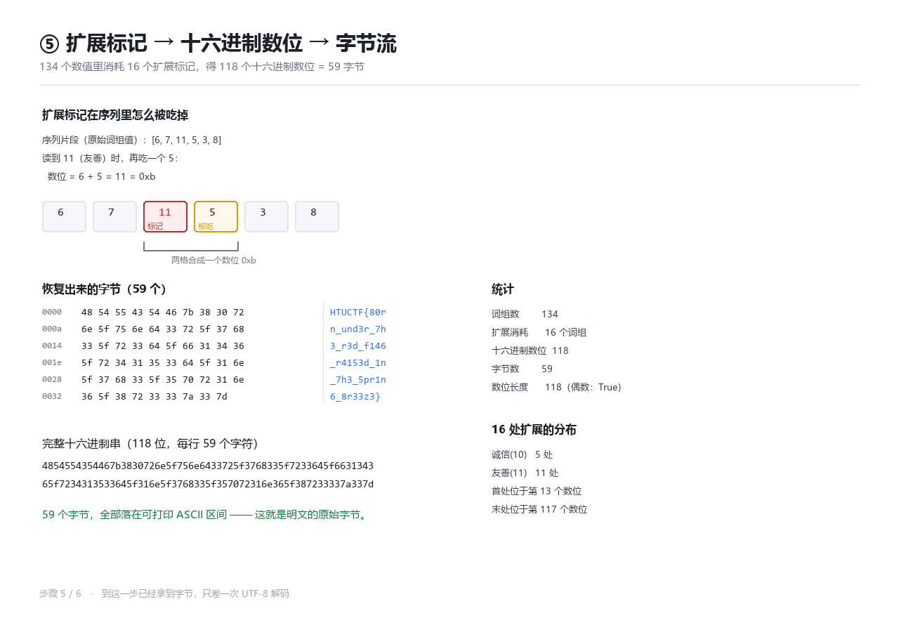
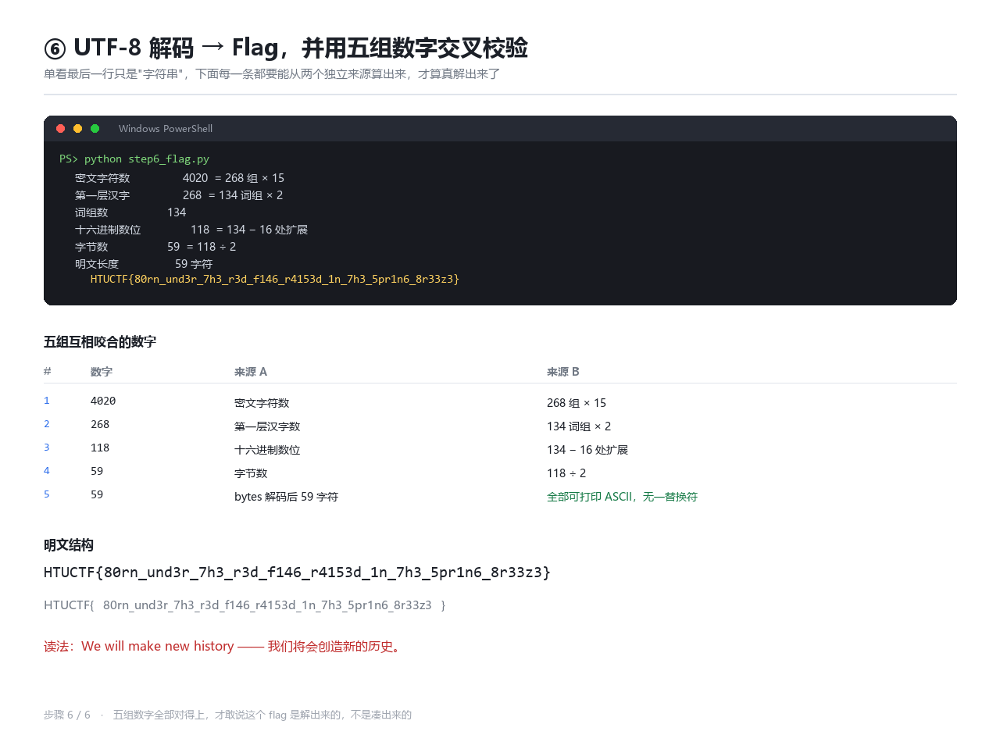

# 哈基米南北绿豆 — Writeup（6 个可单跑的步骤脚本 + 逐步截图）

**题目类别：** Misc / 编码（文件位置：`D:\桌面\htu\misc\爱国小基米`）
**附件：** `哈基米南北绿豆.zip` → `哈基米南北绿豆.txt`（12060 字节）
**Flag：**

```text
HTUCTF{80rn_und3r_7h3_r3d_f146_r4153d_1n_7h3_5pr1n6_8r33z3}
```

读法：`born under the red flag, raised in the spring breeze`（生在红旗下，长在春风里）。

---

## 0. 一句话结论

4020 个 `哈/基/米` 是三进制密文。按 15 个字符一组切（3 位头部 + 12 位数据），
头部给出「循环左移几位」和「读几位」，移位后转十进制、减去偏移得到 Unicode 码点，
第一层还原出 268 个汉字；这 268 个字只由「富强民主文明和谐自由平等公正法治爱国敬业诚信友善」
12 个词组构成 —— 再按核心价值观编码解一层，得到十六进制，转字节即为 flag。

---

## 1. 文件清单

| 步骤 | 脚本 | 输入 | 输出 | 截图 |
|---|---|---|---|---|
| 1 | `step1_unpack.py` | `哈基米南北绿豆.zip` | `work/cipher.txt`（4020 字符） | `步骤截图/01_解包与字符集普查.png` |
| 2 | `step2_parse.py` | `work/cipher.txt` | `work/groups.json`（268 组） | `步骤截图/02_分组与头部参数.png` |
| 3 | `step3_shift.py` | `work/groups.json` | `work/stage1.txt`（268 汉字） | `步骤截图/03_循环左移与码点.png` |
| 4 | `step4_values.py` | `work/stage1.txt` | `work/values.json`（134 数值） | `步骤截图/04_词组映射与数值序列.png` |
| 5 | `step5_hex.py` | `work/values.json` | `work/hex.txt` + `work/stage2.bin` | `步骤截图/05_扩展标记与字节流.png` |
| 6 | `step6_flag.py` | `work/stage2.bin` | 明文 flag | `步骤截图/06_解码与交叉校验.png` |

`_common.py` 只提供画布、字体、画格子这些排版工具，不含任何解题逻辑。
`solve.py` 依次调用 1→6；也可以单独跑某一步，它会自动读上一步落在 `work/` 里的产物。

```bash
python solve.py            # 一次跑完，0.3 秒
python step3_shift.py      # 只重跑第 3 步（重画第 3 张图）
```

---

## 2. 步骤 1：解包 + 字符集普查

**目的**：先确认密文的"字母表"有多大，再决定用什么进制。这一步只统计，不解码。

```bash
python step1_unpack.py
```

**关键代码**：

```python
with ZipFile(src) as z:
    names = [n for n in z.namelist() if n.lower().endswith(".txt")]
    data = z.read(names[0]).decode("utf-8").strip()
(WORK / "cipher.txt").write_text(data, encoding="utf-8")
```

**实测输出**：

```text
哈基米南北绿豆.zip → 哈基米南北绿豆.txt（12060 字节）
字符数 4020，字符集 ['哈', '基', '米']，分布 {'基': 1304, '哈': 1723, '米': 993}
4020 % 15 = 0
```

两组判断：

- 只有 3 个符号 → 天然就是三进制的一位数字（替换密码排除了，3 个符号撑不起字母表）；
- 4020 能被 15 整除 → 15 = 3 位头部 + 12 位数据，后面确实按 15 切。



---

## 3. 步骤 2：按 15 一组切开，读出头部三个参数

**目的**：把长度信息和位移信息从头部解析出来。

```bash
python step2_parse.py
```

**规则**（把 `哈/基/米` 记为 `0/1/2`，头部三位为 `a b c`）：

```text
r    = 3a + b            0 ~ 8      后面循环左移的位数
kind = (c - r) % 3       0 / 1 / 2  决定数据位长度
n    = (6, 9, 12)[kind]             6 / 9 / 12 位三进制
```

**关键代码**：

```python
a, b, c = (TRIT[ch] for ch in header)
r = 3 * a + b
kind = (c - r) % 3
n = LEN_BY_KIND[kind]          # {0: 6, 1: 9, 2: 12}
block = data[pos + 3:pos + 3 + n]
```

**实测输出**：

```text
组数 268，覆盖字符 4020 / 4020
r 分布 {0: 28, 1: 36, 2: 28, 3: 27, 4: 30, 5: 29, 6: 33, 7: 30, 8: 27}
n 分布 {12: 268}
第一组 基哈米 r=3 kind=2 n=12
```

两处值得写下来：

1. `r` 覆盖了 0~8 全部九种取值，说明出题人确实在每组里随机挑了位移量；
2. `kind` 恒为 2，看上去"没有变化"，但实测 **268 组的 `c` 全部满足 `c = (r + 2) % 3`** ——
   `c` 不是独立的长度标记，而是被算出来的：给定 `r`，`c` 只能这么取。这也解释了为什么全都落在 12 位。



---

## 4. 步骤 3：循环左移 → 三进制转十进制 → 减偏移得码点

**目的**：第一层真正解出汉字。

```bash
python step3_shift.py
```

**三步，顺序不能反**：

```text
shifted = digits[r:] + digits[:r]      ① 循环左移 r 位（把头部 r 位搬到末尾）
v       = int(shifted, 3)              ② 三进制转十进制
cp      = v - 3 - r                    ③ 减偏移，得到 Unicode 码点
```

**关键代码**：

```python
for i, g in enumerate(groups):
    d, r = g["digits"], g["r"]
    shifted = d[r:] + d[:r]
    v = int(shifted, 3)
    cp = v - 3 - r
    out.append({**g, "shifted": shifted, "v": v, "cp": cp, "char": chr(cp)})
```

**实测（前三组）**：

```text
基哈米 r=3  000001200122 → 001200122000 → v=33264 → cp=33258 → 自
米哈米 r=6  011111001112 → 001112011111 → v=30010 → cp=30001 → 由
米哈米 r=6  010001001111 → 001111010001 → v=29242 → cp=29233 → 爱
268 组中超出 CJK 基本区的：0
第一层输出 268 字，不同字 24 个
```

> 演示组特意选了第 2 组（`米哈米`）：它的前 6 位是 `011111`，移位后能肉眼看出"前 6 位移到末尾"。
> 第一组前 3 位恰好是 `000`，移位在图上看起来像没动，不适合当示例。

**为什么减 `3 + r`**：只减 3 的话，"左移后在末尾补 r 个 0"会让多个不同的 `r` 落到同一个 `v`，
码点会撞车；减掉 `r` 之后，不同 `r` 的码点区间互相错开，映射是一一对应的。

**第一层输出（268 字，全文）**：

```text
自由爱国平等自由平等平等自由和谐平等自由自由公正法治友善平等和谐爱国和谐富强法治文明公正友善爱国平等友善敬业法治平等公正诚信自由公正自
由和谐和谐法治文明平等友善敬业和谐法治公正爱国和谐和谐平等友善敬业法治文明和谐和谐公正自由平等友善敬业公正公正和谐民主和谐自由和谐公正
平等友善敬业法治文明和谐自由和谐民主和谐平等和谐和谐公正自由平等友善敬业和谐民主公正友善爱国平等友善敬业和谐法治公正爱国和谐和谐平等诚
信平等和谐平等法治富强法治文明和谐民主公正诚信自由和谐公正平等诚信平等和谐爱国法治文明和谐和谐和谐和谐法治诚信富强和谐和谐法治友善法治
```

268 个字里只有 24 个不同的字，全部来自一个固定集合：
**富强 民主 文明 和谐 自由 平等 公正 法治 爱国 敬业 诚信 友善** —— 第一层到此结束。



---

## 5. 步骤 4：核心价值观词组 → 数值

**目的**：把 268 个汉字翻译成 0~11 的数字，并找出"扩展标记"。

```bash
python step4_values.py
```

**字母表**（官方顺序，每个词组占两位汉字）：

```text
富强 0   民主 1   文明 2   和谐 3
自由 4   平等 5   公正 6   法治 7
爱国 8   敬业 9   诚信 10  友善 11
```

**关键代码**：

```python
ALPHABET = "富强民主文明和谐自由平等公正法治爱国敬业诚信友善"
PHRASES = [ALPHABET[i:i + 2] for i in range(0, len(ALPHABET), 2)]
VALUE_OF = {w: i for i, w in enumerate(PHRASES)}
values = [VALUE_OF[text[i:i + 2]] for i in range(0, len(text), 2)]
```

**实测输出**：

```text
词组数 134，取值集合 [0, 1, 2, 3, 4, 5, 6, 7, 8, 9, 10, 11]
10 出现 5 次，11 出现 11 次，合计 16
预计数位 = 134 - 16 = 118
```

**为什么要有扩展标记**：12 个词组只能表示 0~11，但十六进制要 0~15。
于是 10 和 11 改当"进位开关"：

```text
读到 10（诚信） → 再读一个词组 n → 数位 = 10 + n   → 0xa ~ 0xf
读到 11（友善） → 再读一个词组 n → 数位 =  6 + n   → 0xa ~ 0xf
```

两条路都能到 10~15，至于用哪条，由后一个词组的取值范围自然决定（本题 `诚信` 后面接 0~5，`友善` 后面接 4~9，都不越界）。



---

## 6. 步骤 5：扩展标记 → 十六进制数位 → 字节流

**目的**：把 134 个数值压成 118 个数位，再两两拼成字节。

```bash
python step5_hex.py
```

**关键代码**：

```python
while i < len(values):
    v = values[i]; i += 1
    if v in (10, 11):
        nxt = values[i]; i += 1
        base = 10 if v == 10 else 6
        used.append({"at": len(digits), "mark": v, "next": nxt, "value": base + nxt})
        v = base + nxt
    digits.append(v)

hex_text = "".join(format(d, "x") for d in digits)
data = bytes.fromhex(hex_text)
```

**实测输出**：

```text
数位 118，扩展消耗 16，字节 59
首处扩展：第 13 个数位，11→6 + 5 = 11 = 0xb
```

首处扩展在序列里的样子（原始词组值片段 `[6, 7, 11, 5, 3, 8]`）：
读到 `11`（友善）时再吃一个 `5`，两格合成一个数位 `0xb`。16 处分部零散，**不能按固定位置跳过**。

**完整十六进制串（118 位）**：

```text
4854554354467b3830726e5f756e6433725f3768335f7233645f663134365f7234313533645f316e5f3768335f357072316e365f387233337a337d
```

**hexdump（59 字节）**：

```text
0000  48 54 55 43 54 46 7b 38 30 72   HTUCTF{80r
000a  6e 5f 75 6e 64 33 72 5f 37 68   n_und3r_7h
0014  33 5f 72 33 64 5f 66 31 34 36   3_r3d_f146
001e  5f 72 34 31 35 33 64 5f 31 6e   _r4153d_1n
0028  5f 37 68 33 5f 35 70 72 31 6e   _7h3_5pr1n
0032  36 5f 38 72 33 33 7a 33 7d      6_8r33z3}
```

59 个字节全部落在可打印 ASCII 区间。



---

## 7. 步骤 6：UTF-8 解码 + 交叉校验

```bash
python step6_flag.py
```

**关键代码**：

```python
data = (WORK / "stage2.bin").read_bytes()
flag = data.decode("utf-8")
if any(ord(c) < 32 or ord(c) > 126 for c in flag):
    raise SystemExit("解出的明文含不可打印字符，规则大概率有误")
```

**实测**：

```text
明文 59 字符：HTUCTF{80rn_und3r_7h3_r3d_f146_r4153d_1n_7h3_5pr1n6_8r33z3}
```

**五组互相咬合的数字**（每条都从两个独立来源算出来，对得上才敢说解对了）：

| # | 数字 | 来源 A | 来源 B |
|---|---|---|---|
| 1 | 4020 | 密文实际字符数 | 268 组 × 15 |
| 2 | 268 | 第一层解出的汉字数 | 134 词组 × 2 |
| 3 | 118 | 十六进制数位长度 | 134 − 16 处扩展 |
| 4 | 59 | 字节数 | 118 ÷ 2 |
| 5 | 59 | 明文长度 | 全部可打印 ASCII，无一替换符 |



---

## 8. 全量中间结果（不省略）

**① 268 个汉字**见第 4 节。

**② 134 个数值**（按顺序，每行 34 个）：

```text
 4  8  5  4  5  5  4  3  5  4  4  6  7 11  5  3  8  3  0  7  2  6 11  8  5 11  9  7  5  6 10  4  6  4
 3  3  7  2  5 11  9  3  7  6  8  3  3  5 11  9  7  2  3  3  6  4  5 11  9  6  6  3  1  3  4  3  6  5
11  9  7  2  3  4  3  1  3  5  3  3  6  4  5 11  9  3  1  6 11  8  5 11  9  3  7  6  8  3  3  5 10  5
 3  5  7  0  7  2  3  1  6 10  4  3  6  5 10  5  3  8  7  2  3  3  3  3  7 10  0  3  3  7 11  7
```

**③ 118 个十六进制数位**见第 6 节（与 59 字节一一对应）。

**④ 59 字节明文**：

```text
HTUCTF{80rn_und3r_7h3_r3d_f146_r4153d_1n_7h3_5pr1n6_8r33z3}
```

**⑤ 分组统计**：

```text
组数        268
r 分布      0:28  1:36  2:28  3:27  4:30  5:29  6:33  7:30  8:27
n 分布      6:0   9:0   12:268
kind        全部 = 2   （c = (r+2)%3 恒成立）
扩展标记    诚信 5 处 / 友善 11 处，合计 16
```

---

## 9. 复现

```bash
cd D:\桌面\htu\misc\爱国小基米
python solve.py
```

或者逐步执行，每一步都会在 `步骤截图/` 落一张图：

```bash
python step1_unpack.py
python step2_parse.py
python step3_shift.py
python step4_values.py
python step5_hex.py
python step6_flag.py
```

脚本里的断言是硬断言：

- 头部不足 3 位、数据位不足 n 位 → `ValueError`；
- 解出的码点不在 CJK 基本区（0x4E00~0x9FFF） → `AssertionError`；
- 出现字母表外的词组、数位越界、扩展标记在末尾 → 直接报错；
- 明文含不可打印字符 → `SystemExit`。

也就是说，任何一步规则写错，都会当场炸，而不是给你一串"看着像 flag"的东西。

---

> 文中所有数字都来自本机实际运行输出（`python solve.py`，0.3s）；脚本、截图、`work/` 中间产物均在同目录，可原样复跑。
